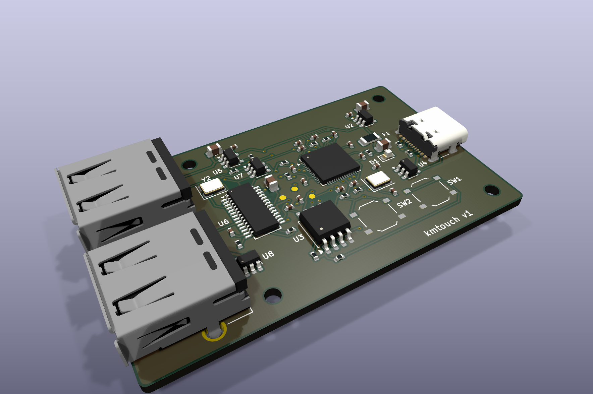
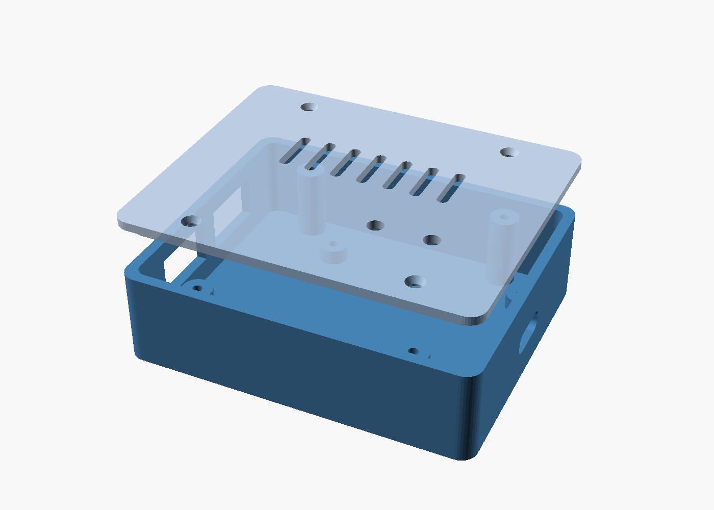

# kmtouch — بازی با موس و کیبورد روی اندروید (بدون روت، بدون ADB)

kmtouch یه گجت کوچیک با **دو پورت USB-A** (موس و کیبورد) و **یه پورت USB-C** (به گوشی) است.
گجت خودش رو به گوشی یه **صفحه‌لمسی چندلمسی HID** معرفی می‌کنه و کلیدها و حرکت موس رو به «لمس» روی نقطه‌های دلخواه صفحه تبدیل می‌کنه (مثل کی‌مپرهای تجاری).
برق کل مدار (و موس و کیبورد) از خود گوشی میاد.

[English](README.md) | **فارسی**




## چطوری کار می‌کنه
```
موس ──USB-A─┐
             ├─ هاب FE1.1s ── PIO-USB (GPIO2/3) ─┐
کیبورد ─USB-A┘                                   │  RP2040
گوشی ◄──USB-C (USB اصلی RP2040، حالت Device) ◄───┘  (هسته۱: هاست، هسته۰: تاچ‌اسکرین + مپر)
```
- گوشی **میزبان USB** است و ۵ ولت VBUS می‌ده. مقاومت‌های 5.1k روی CC1/CC2 باعث می‌شه گوشی (C به C) برق رو روشن کنه.
- RP2040 با **TinyUSB** روی پورت اصلی USB خودش به‌عنوان دستگاه HID شناخته می‌شه: یه تاچ‌اسکرین ۵ لمسی (مختصات 0 تا 32767) + یه موس معمولی.
- هاست USB برای موس و کیبورد با **Pico-PIO-USB** (USB نرم‌افزاری با PIO) ساخته شده. چون TinyUSB روی PIO-USB فقط یه پورت ریشه رو مدیریت می‌کنه، یه هاب کوچیک FE1.1s دو تا پورت USB-A رو می‌سازه.
- اندروید از تاچ‌اسکرین‌های HID به‌صورت پیش‌فرض پشتیبانی می‌کنه (درایور hid-multitouch)، پس **روت، ADB و اپ لازم نیست**.

### مپ پیش‌فرض (حالت بازی)
| ورودی | کار |
|---|---|
| W A S D | جوی‌استیک مجازی (یه انگشت روی جوی‌استیک، به جهت کلیدها) |
| حرکت موس | کشیدن انگشت در ناحیه‌ی دوربین (وقتی به لبه‌ی ناحیه برسه، خودکار برمی‌داره و از وسط دوباره شروع می‌کنه) |
| کلیک چپ / راست / وسط | تپ روی دکمه‌ی شلیک / نشانه / ... |
| Space, C, R, F, Shift, 1, 2, Tab, Esc | تپ روی نقطه‌های تعریف‌شده |
| کلید ` (بالای Tab) | سوییچ بین **حالت بازی** و **حالت نشانگر** (موس معمولی اندروید) |

حداکثر ۵ لمس هم‌زمان: ۱ جوی‌استیک + ۱ دوربین + ۳ دکمه.

## ساختار پوشه‌ها
```
firmware/            سورس فریم‌ور (C، Pico SDK + TinyUSB + Pico-PIO-USB)
  keymap.json        تنظیم کلیدها (این رو ویرایش کن)
  tools/json2keymap.py  تبدیل JSON به src/keymap_gen.h (موقع build خودکار)
  src/               main.c, mapper.c, usb_descriptors.c, tusb_config.h
firmware_bin/        فایل‌های uf2 آماده
hardware/            نت‌لیست، BOM، سیم‌کشی برد آماده
  kicad/             پروژه KiCad 9، اسکریپت‌های تولید (gen/)، خروجی ساخت (out/)
case/                سورس OpenSCAD پارامتریک + STL + تصویر پیش‌نمایش
```

## فایل‌های آماده
- `firmware_bin/kmtouch_pico_custom_dp2.uf2` — برد سفارشی، Raspberry Pi Pico یا RP2040-Zero (PIO-USB روی GPIO2=D+ و GPIO3=D−)
- `firmware_bin/kmtouch_feather_usbhost_dp16.uf2` — Adafruit Feather RP2040 USB Host (پورت USB-A روی GPIO16/17، برق 5V با GPIO18)

## فلش کردن
1. دکمه‌ی **BOOTSEL** رو نگه دار و برد رو با کابل به کامپیوتر وصل کن.
2. یه درایو به اسم `RPI-RP2` ظاهر می‌شه؛ فایل `.uf2` رو داخلش کپی کن. برد خودکار ری‌استارت می‌شه.

## Build از سورس
```bash
# پیش‌نیاز: cmake, ninja یا make, arm-none-eabi-gcc, python3
git clone -b 2.1.1 https://github.com/raspberrypi/pico-sdk && (cd pico-sdk && git submodule update --init lib/tinyusb)
git clone https://github.com/sekigon-gonnoc/Pico-PIO-USB
export PICO_SDK_PATH=$PWD/pico-sdk
cd firmware
cmake -B build -DPICO_PIO_USB_PATH=$PWD/../Pico-PIO-USB            # برد سفارشی / Pico
# یا: cmake -B build -DKMT_PIO_DP_PIN=16 -DPICO_BOARD=adafruit_feather_rp2040_usb_host
cmake --build build      # خروجی: build/kmtouch.uf2
```
(این پروژه روی همین سیستم با pico-sdk 2.1.1 و arm-gnu-toolchain 13.3 بدون خطا build شده.)

## تنظیم کلیدها (keymap)
فایل `firmware/keymap.json` رو ویرایش کن. مختصات **کسری از صفحه** هستن (0.0 تا 1.0)، صفحه‌ی **افقی (landscape)**؛ (0,0) گوشه‌ی بالا-چپ.
```json
"joystick": {"x": 0.18, "y": 0.72, "radius": 0.09, "up": "W", "down": "S", "left": "A", "right": "D"},
"look": {"x": 0.65, "y": 0.45, "half_w": 0.25, "half_h": 0.30, "sens_x": 18, "sens_y": 18},
"keys": [ {"key": "SPACE", "x": 0.92, "y": 0.80}, ... ]
```
- `toggle_mode_key`: کلید سوییچ حالت (پیش‌فرض `GRAVE` یعنی `).
- `look_hold_key`: اگه بذاری مثلاً `ALT`، دوربین فقط وقتی اون کلید نگه داشته شده کار می‌کنه (`NONE` = همیشه).
- `sens_x/sens_y`: حساسیت موس.
- اسم کلیدها: A–Z، 0–9، F1–F12، SPACE، ENTER، ESC، TAB، SHIFT، CTRL، ALT، UP/DOWN/LEFT/RIGHT و ...
- **پیدا کردن مختصات:** در گوشی Developer options ← «Pointer location» رو روشن کن، دکمه‌ی بازی رو لمس کن، X و Y رو بخون و تقسیم بر عرض/ارتفاع صفحه کن.
- بعد از ویرایش دوباره build و فلش کن.

## نکته‌های اندروید
- گوشی باید **USB OTG** داشته باشه (تقریباً همه‌ی گوشی‌های جدید دارن؛ بعضی‌ها مثل شیائومی/اوپو باید OTG رو در تنظیمات روشن کنی).
- مختصات تاچ روی **کل صفحه‌ی نمایش** مپ می‌شه. اگه چرخش صفحه عوض بشه، اندروید خودش مختصات رو می‌چرخونه؛ keymap رو برای حالت افقی بازی بساز.
- اگه بعد از وصل شدن یه نقطه‌ی سفید/نشانگر دیدی، طبیعیه؛ در حالت نشانگر، موس معمولی اندروید کار می‌کنه.
- مصرف برق: خیلی از گوشی‌ها حداکثر حدود 500mA برای OTG می‌دن؛ کیبوردهای RGB پرمصرف ممکنه قطع و وصل بشن.
- گوشی موقع استفاده شارژ نمی‌شه (همون یه پورت درگیره).
- بعضی بازی‌ها (مثلاً PUBG/CoD موبایل) ممکنه ورودی غیرلمسی یا الگوی غیرطبیعی رو تشخیص بدن؛ استفاده به مسئولیت خودت و طبق قوانین هر بازی.

## سخت‌افزار
### مسیر ساده (برد آماده)
جزئیات و سیم‌کشی: [`hardware/WIRING.md`](hardware/WIRING.md)
- **Adafruit Feather RP2040 USB Host** (ساده‌ترین): USB-C خودش به گوشی، USB-A خودش به یه هاب کوچیک (یا دانگل بی‌سیم موس+کیبورد که یه گیرنده داره).
- **Waveshare RP2040-Zero** یا **Raspberry Pi Pico**: یه مادگی USB-A یا ماژول هاب رو با دو مقاومت 22Ω به GPIO2/GPIO3 وصل کن.

### برد اختصاصی
- پروژه‌ی کامل KiCad 9 (شماتیک + PCB مسیرکشی‌شده): `hardware/kicad/` — PDF شماتیک: `hardware/kicad/out/kmtouch_schematic.pdf`
- شماتیک بلوکی قدیمی: `hardware/schematic.svg` / `schematic.png`
- نت‌لیست پین‌به‌پین: `hardware/netlist.txt`
- فهرست قطعات با پارت‌نامبر و کد LCSC: `hardware/BOM.csv`

قطعه‌های اصلی: RP2040، فلش W25Q128JV، کریستال 12MHz، رگولاتور AP2112K-3.3، کانکتور USB-C با 5.1k روی CC (UFP)، USBLC6-2SC6 برای ESD، فیوز PTC 0.5A، لود سوییچ TPS2051C برای VBUS پورت‌های A، مقاومت‌های 27Ω (USB اصلی) و 22Ω (PIO-USB)، هاب FE1.1s و دو مادگی USB-A.

## سفارش ساخت PCB (JLCPCB)
پروژه‌ی کامل KiCad 9 در `hardware/kicad/` است (شماتیک، برد ۶۰×۳۶ میلی‌متر دولایه، مسیرکشی‌شده، DRC و ERC بدون خطا).

فایل‌های آماده در `hardware/kicad/out/`:
- `kmtouch_gerbers_jlcpcb.zip` — گربر + دریل (همین را آپلود کنید)
- `kmtouch_bom_jlcpcb.csv` — BOM با فرمت JLCPCB (کد LCSC)
- `kmtouch_cpl_jlcpcb.csv` — فایل جایگذاری قطعات (CPL / Pick&Place)
- `render/` — تصویر سه‌بعدی و دوبعدی برد و شماتیک

مراحل:
1. در jlcpcb.com گزینه‌ی Order now را بزنید و فایل zip گربر را آپلود کنید.
2. تنظیمات: ۲ لایه، ضخامت ۱٫۶ میلی‌متر، ابعاد ۶۰×۳۶ (خودکار تشخیص داده می‌شود)، بقیه پیش‌فرض.
3. برای مونتاژ، PCB Assembly را روشن کنید (سمت Top)، سپس BOM و CPL را آپلود کنید.
4. در پیش‌نمایش جایگذاری، جهت قطعات را چک کنید (به‌خصوص RP2040، FE1.1s، فلش، SOT-23ها و کانکتور USB-C)؛ اگر قطعه‌ای چرخیده بود همان‌جا اصلاحش کنید.
5. موجودی قطعات را چک کنید؛ اگر قطعه‌ای ناموجود بود، معادل همان پکیج را انتخاب کنید.

نکته‌ها:
- کانکتورهای USB-A (J2,J3) از نوع THT هستند؛ یا مونتاژ THT را هم سفارش دهید (هزینه بیشتر) یا خودتان لحیم کنید.
- کانکتور USB-C (GCT USB4105, C3020560) ممکن است در LCSC ناموجود باشد؛ معادل pin-compatible (USB-C 16 پین TopMount) انتخاب کنید.
- مسیرهای USB کوتاه‌اند ولی امپدانس کنترل‌شده نیستند؛ برای USB Full-Speed (12Mbps) کافی است.
- دکمه‌های BOOTSEL و RESET از سوراخ‌های درِ قاب با یک سوزن/خلال فشار داده می‌شوند.
- قاب (`case/`) با محل سوراخ‌ها و کانکتورهای همین برد هماهنگ شده است؛ پیچ M2.

## قاب (پرینت سه‌بعدی)
- `case/kmtouch_case_base.stl` (کف) و `case/kmtouch_case_lid.stl` (درب)؛ `kmtouch_case_both.stl` هر دو کنار هم.
- سورس پارامتریک: `case/kmtouch_case.scad` (ابعاد PCB، ضخامت دیواره، جای پورت‌ها همه قابل تغییر). برای برد آماده، `pcb_w/pcb_d` و `usba_y` رو تنظیم کن.
- پرینت: PLA یا PETG، لایه 0.2mm، دیواره 3 لاین، بدون ساپورت (درب رو برعکس پرینت کن). بستن: ۴ پیچ M2×6 خودکار؛ لبه‌ی داخلی درب برای جاافتادن.

## منابع و الهام
- [jfedor2/hid-remapper](https://github.com/jfedor2/hid-remapper) — RP2040 + PIO-USB host برای ریمپ HID
- [sekigon-gonnoc/Pico-PIO-USB](https://github.com/sekigon-gonnoc/Pico-PIO-USB)
- [hathach/tinyusb](https://github.com/hathach/tinyusb) و Pico SDK
- Microsoft «HID touchscreen / Windows Precision Touch» descriptor guide، و درایور hid-multitouch لینوکس/اندروید
- Raspberry Pi «Hardware design with RP2040» (طراحی مینیمال)

## محدودیت‌ها
- فریم‌ور روی سخت‌افزار واقعی تست نشده (فقط کامپایل شده). احتمالاً باید حساسیت و مختصات رو با بازی خودت تنظیم کنی.
- موس/کیبورد در حالت **Boot protocol** خونده می‌شن: موس‌های گیمینگ با DPI بالا کار می‌کنن ولی دکمه‌های اضافه (۴ و ۵) و چرخ‌های خاص ممکنه نادیده گرفته بشن.
- موس‌های Low-speed پشت هاب با PIO-USB در بعضی موارد مشکل دارن؛ اگه دیدی، دستگاه رو مستقیم (بدون هاب) تست کن.
- برد KiCad از DRC/ERC بدون خطا رد شده ولی هنوز ساخته و تست نشده؛ قبل از سفارش انبوه، اول ۵ عدد بسازید و تست کنید.
- VID/PID از محدوده‌ی تست pid.codes است؛ برای فروش PID اختصاصی بگیر.

## مجوز
- فریم‌ور و اسکریپت‌ها: MIT — [`LICENSE`](LICENSE)
- سخت‌افزار (KiCad، قاب): CERN-OHL-P v2 — [`hardware/LICENSE`](hardware/LICENSE)
