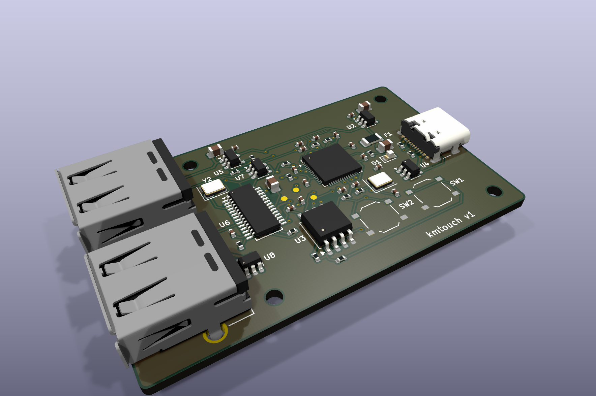
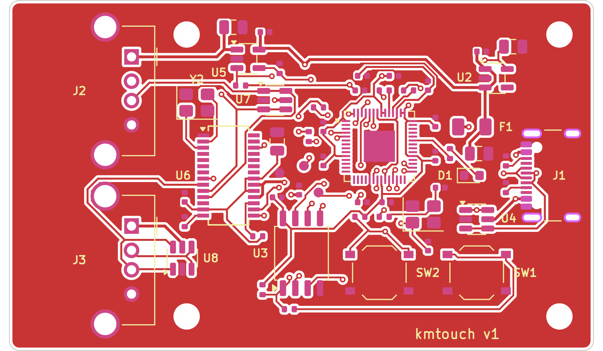
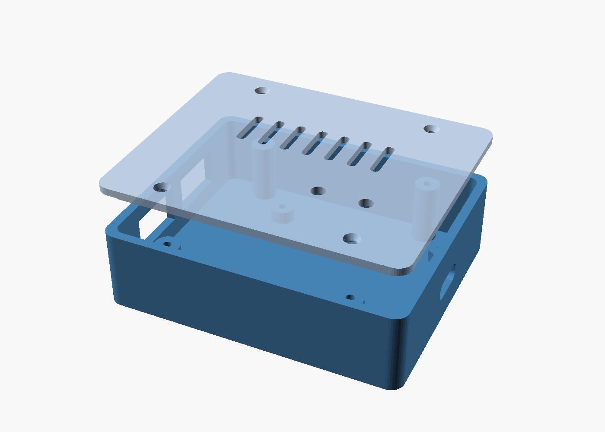

# kmtouch — Mouse & keyboard to touchscreen adapter for Android

**English** | [فارسی](README.fa.md)

kmtouch is a small RP2040-based USB gadget with **two USB-A ports** (mouse + keyboard) and **one USB-C port** (to the phone).
It enumerates on the phone as a standard **HID multitouch touchscreen** and turns key presses and mouse movement into touches at configurable screen positions — like a commercial "keymapper", but open source.
The phone powers everything. **No root, no ADB, no companion app.**

| 3D render | Top copper/silk | Case |
|---|---|---|
|  |  |  |

## How it works
```
mouse ────USB-A─┐
                ├─ FE1.1s hub ── PIO-USB host (GPIO2/3) ─┐
keyboard ─USB-A─┘                                         │  RP2040
phone ◄───USB-C (native USB, device mode) ◄───────────────┘  core1: USB host, core0: touchscreen + mapper
```
- The phone is the USB host and supplies 5 V on VBUS; 5.1 kΩ pull-downs on CC1/CC2 make C-to-C cables work.
- TinyUSB exposes a 5-finger HID touchscreen (0–32767 logical range) plus a regular mouse on the RP2040 native USB port.
- Mouse/keyboard are read through **Pico-PIO-USB** (software USB host on PIO) behind a small FE1.1s hub.
- Android supports HID touchscreens out of the box (`hid-multitouch`).

### Default game mapping
| Input | Action |
|---|---|
| W A S D | Virtual joystick |
| Mouse move | Drag in the camera area (auto re-centres at the edge) |
| Left / right / middle click | Tap fire / aim / … |
| Space, C, R, F, Shift, 1, 2, Tab, Esc | Taps at configured points |
| `` ` `` (grave) | Toggle **game mode** ↔ **pointer mode** (normal Android mouse) |

Up to 5 simultaneous touches (joystick + camera + 3 buttons).

## Repository layout
```
firmware/          C firmware (Pico SDK + TinyUSB + Pico-PIO-USB)
  keymap.json      key mapping — edit this
  tools/           json2keymap.py (generates src/keymap_gen.h at build time)
  src/             main.c, mapper.c, usb_descriptors.c, tusb_config.h
firmware_bin/      prebuilt .uf2 images
hardware/
  kicad/           KiCad 9 project (schematic + routed 60×36 mm 2-layer PCB)
    gen/           Python scripts that generate/place/route the board (run_all.sh)
    tools/         small debug helpers
    out/           fabrication output: Gerber zip, JLCPCB BOM + CPL, renders, schematic PDF
  BOM.csv, netlist.txt, WIRING.md (dev-board wiring)
case/              parametric OpenSCAD case + STLs + previews
```

## Prebuilt firmware
- `firmware_bin/kmtouch_pico_custom_dp2.uf2` — kmtouch PCB, Raspberry Pi Pico or RP2040-Zero (PIO-USB D+ = GPIO2, D− = GPIO3)
- `firmware_bin/kmtouch_feather_usbhost_dp16.uf2` — Adafruit Feather RP2040 USB Host

## Flashing
Hold **BOOTSEL**, plug the board into a computer, copy the `.uf2` onto the `RPI-RP2` drive. It reboots automatically.
On the kmtouch PCB, BOOTSEL and RESET are reachable through pin holes in the lid.

## Building from source
```bash
# needs: cmake, ninja/make, arm-none-eabi-gcc, python3
git clone -b 2.1.1 https://github.com/raspberrypi/pico-sdk && (cd pico-sdk && git submodule update --init lib/tinyusb)
git clone https://github.com/sekigon-gonnoc/Pico-PIO-USB
export PICO_SDK_PATH=$PWD/pico-sdk
cd firmware
cmake -B build -DPICO_PIO_USB_PATH=$PWD/../Pico-PIO-USB
# Feather: cmake -B build -DKMT_PIO_DP_PIN=16 -DPICO_BOARD=adafruit_feather_rp2040_usb_host
cmake --build build        # -> build/kmtouch.uf2
```

## Configuring the keymap
Edit `firmware/keymap.json`. Coordinates are fractions of the **landscape** screen (0.0–1.0, origin top-left).
Use Android *Developer options → Pointer location* to read positions of on-screen game buttons. Rebuild and reflash after editing.

## Hardware
- RP2040, W25Q128JV flash, 12 MHz crystal, AP2112K-3.3 LDO, USB4105 USB-C (UFP), USBLC6-2SC6 ESD, 0.5 A PTC, TPS2051C load switch for USB-A VBUS, FE1.1s hub, 2× Molex 67643 USB-A.
- 60 × 36 mm, 2 layers, 1.6 mm, all SMD parts on top; USB-A connectors are through-hole.
- ERC: 0 violations. DRC (with schematic parity): 0 violations, 0 unconnected.
- Regenerate everything with `hardware/kicad/gen/run_all.sh` (KiCad 9 + Freerouting 1.9).

### Ordering the PCB (JLCPCB)
1. Upload `hardware/kicad/out/kmtouch_gerbers_jlcpcb.zip` (2 layers, 1.6 mm, HASL or ENIG).
2. Enable PCB Assembly (top side) and upload `kmtouch_bom_jlcpcb.csv` and `kmtouch_cpl_jlcpcb.csv`.
3. Check part rotations in the placement preview (QFN/SSOP/SOT-23/USB-C) and part stock; substitute equivalents if needed.
4. USB-A connectors (THT): order THT assembly or hand-solder.

## Case
`case/kmtouch_case.scad` (OpenSCAD, parametric) → `kmtouch_case_base.stl`, `kmtouch_case_lid.stl`. PLA or PETG, 0.2 mm layers, no supports; 4× M2 screws for the PCB and 4× M2 for the lid.

## Limitations
- Firmware compiles but has not been tested on real hardware yet; the PCB has not been fabricated yet — build 5 units first.
- Boot-protocol mouse/keyboard: extra mouse buttons may be ignored.
- USB D+/D− are short traces, not impedance-controlled pairs (fine for Full-Speed 12 Mbps).
- Most phones supply ≈500 mA on OTG; RGB keyboards may brown out. The phone does not charge while connected.
- Some games may detect or forbid input devices; use responsibly.
- VID/PID are from the pid.codes test range.

## Credits
[hid-remapper](https://github.com/jfedor2/hid-remapper), [Pico-PIO-USB](https://github.com/sekigon-gonnoc/Pico-PIO-USB), [TinyUSB](https://github.com/hathach/tinyusb), Raspberry Pi *Hardware design with RP2040*.

## License
- Firmware and scripts: MIT — [`LICENSE`](LICENSE)
- Hardware (KiCad project, case): CERN-OHL-P v2 — [`hardware/LICENSE`](hardware/LICENSE), also applies to `case/`
